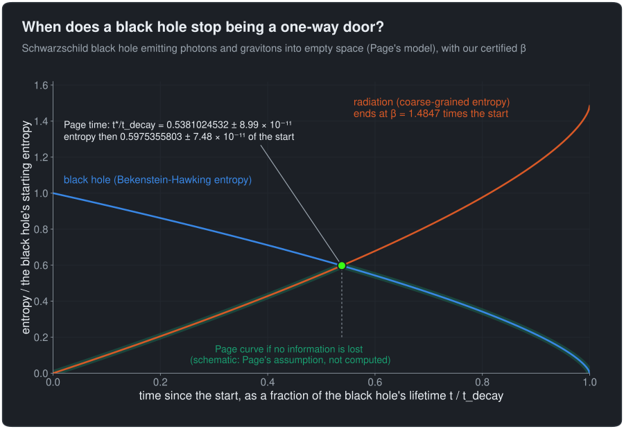
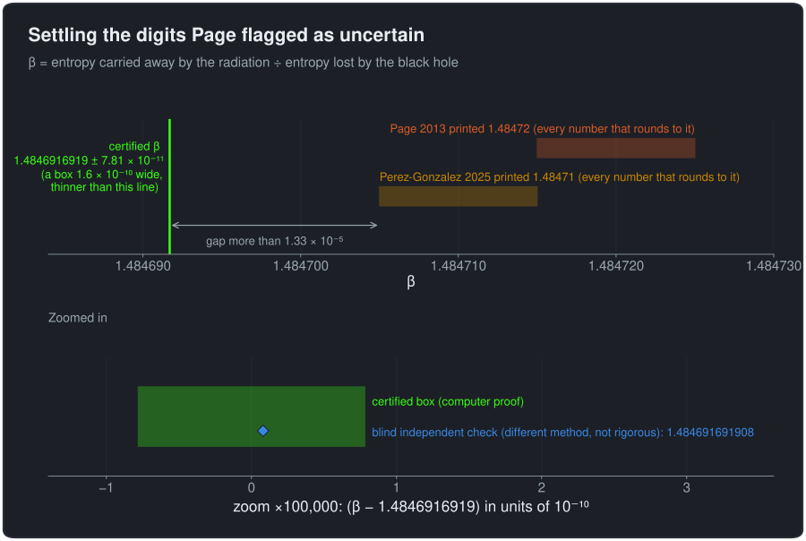
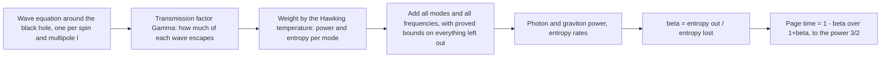
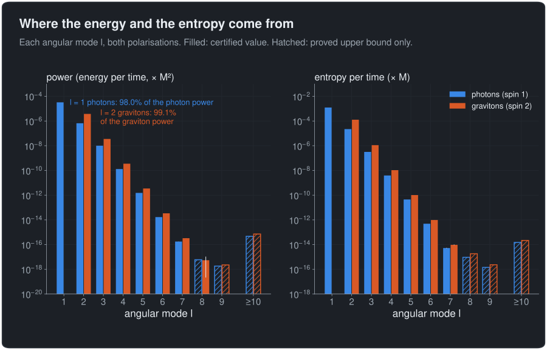

# When does a black hole stop being a one-way door?

**To our knowledge, the first certified (interval-arithmetic, rigorously error-bounded) enclosures of Page's evaporation
constants for a Schwarzschild black hole emitting photons and gravitons into empty space: β = 1.4846916919 ± 7.81e-11
and Page time t*/t_decay = 0.5381024532 ± 8.99e-11, together with the certified photon power, the total power α and the
photon and graviton entropy rates. The graviton power, and so the graviton part of α, was certified earlier by
Newton (Zenodo 10.5281/zenodo.22800587) to 1% width; our independent enclosure lies inside his interval and is about seven orders of
magnitude narrower. The result settles the digits Page (2013) flagged as uncertain.**

 [](https://github.com/Hashirama1337s)

Moki & Julio · 2026 · version 1.0

**Read** [paper.md](paper.md) · **Re-run** [tools/reproduce.md](tools/reproduce.md) · **Check** [CLAIMS.md](CLAIMS.md) and [SCORECARD.md](SCORECARD.md)

**The magic trick.** For every unit of entropy a black hole in Page's model (photons and gravitons into empty space)
loses, its radiation carries away 1.4846916919 ± 0.0000000001 units. Page
printed this number in 2013 as 1.48472 and left its last digits as a challenge. A computer proof now traps it in a box
0.00000000016 wide; a second program, written blind with a different method, lands inside that box. And the same number
fixes the moment when, if no information is lost, the black hole must start giving it back: at 53.81% of its life.



*Entropy over the life of an evaporating Schwarzschild black hole that emits only photons and gravitons (Page's model). Blue:
the black hole's own entropy, which falls as (1 − t/t_decay)^(2/3). Orange: the coarse-grained entropy of the radiation,
which rises β times faster than the black hole's falls and ends at β = 1.4847 times the starting entropy. Both curves are
Page's closed-form model evaluated with our certified β. Green dot: the Page time t*/t_decay = 0.5381024532 ± 8.99 × 10⁻¹¹,
where the two are equal, at 0.5975355803 ± 7.48 × 10⁻¹¹ of the starting entropy (certified; the boxes are far thinner
than the dot). The pale green band, the "Page curve", is what quantum theory predicts if no information is lost; it is
Page's assumption, drawn as a schematic, and nothing here computes or proves it.*

## In plain words

A black hole is not perfectly black. Stephen Hawking showed in 1974 that it glows faintly, and slowly evaporates. Our
work is about the bookkeeping of that glow, counted in **entropy**: a measure of how many hidden ways a thing can be
arranged, the physicist's word for missing information.

A black hole has an entropy fixed by the area of its surface. As it shrinks, that entropy goes down; the radiation it
sends out carries entropy away, and the radiation's entropy goes up faster. How much faster is one number, β: **for every
unit of entropy the black hole loses, the radiation carries about 1.4847 units.**

Don Page turned this bookkeeping into a clock. If quantum theory is right that information is never destroyed,
the information that fell in must start coming back out once the radiation holds more entropy than the black hole has
left. That moment is now called the **Page time**: the moment a black hole stops being a one-way door. For a large,
non-spinning black hole that emits only light (photons) and gravitational waves (gravitons), β fixes it exactly: the
Page time comes after **53.81% of its life**. At that moment the black hole still has 77% of its mass but has already lost
40% of its entropy.

Page computed β and his other constants with a computer and wrote that only about four or five digits were reliable;
he printed more digits "as a challenge for someone to do a higher-precision calculation" (Page 2013, arXiv:1301.4995v3,
the sentence after Eq. (2)). We took up that challenge with **ball arithmetic**: every number in the computer carries a
guaranteed error radius, every rounding goes outward, and every infinite sum and every cut-off integral gets a proved
bound. What comes out is not an estimate but a box that provably contains the true value. β lies in a box 1.6 × 10⁻¹⁰
wide, and the Page time in one 1.8 × 10⁻¹⁰ wide.

**The idea in one picture.** Two bank accounts: the black hole's entropy and the radiation's. Every withdrawal from the
first deposits 1.4847 times as much into the second, so the two balances cross at a fixed fraction of the black hole's
life. **Where the picture breaks.** The radiation's "deposit" is coarse-grained entropy, which ignores the quantum links
between the radiation and the hole. Whether the true (fine-grained) entropy really turns around at the Page time, the
information paradox, is a question about quantum gravity that this work does not touch.



*Top: the certified β (green line; its box is 1.6 × 10⁻¹⁰ wide, thinner than the line) and every number that rounds to
the published float values 1.48472 (Page 2013) and 1.48471 (Perez-Gonzalez 2025). The gap to the nearer interval is more
than 1.33 × 10⁻⁵ (about 9 parts per million); the printed 1.48471 itself lies about 12 parts per million above the
certified β. Bottom, magnified 100,000 times: the certified box and the value of the blind
second implementation (a different equation and method, not rigorous), 1.484691691908, which lies inside it.*

## At a glance

- **Claim (computer-assisted proof).** For a Schwarzschild black hole of mass M emitting photons (spin 1) and gravitons
  (spin 2) into empty space, in Planck units, with Page's definitions: β ∈ [1.4846916919 ± 7.81e-11]; Page time
  t*/t_decay ∈ [0.5381024532 ± 8.99e-11]; photon power M²P₁ ∈ [3.3638547856e-5 ± 2.57e-16]; total power α = M²(P₁ + P₂) ∈
  [3.747528778e-5 ± 1.96e-15]; photon entropy rate M·Ṡ₁ ∈ [1.2683659541e-3 ± 2.47e-14]; graviton entropy rate
  M·Ṡ₂ ∈ [1.300008786e-4 ± 5.55e-14]; graviton power M²P₂ ∈ [3.836739925e-6 ± 6.95e-16].
- **Status.** PROVED, computer-assisted: refereed twice by an internal hostile referee seat (an internal lab check, not
  external peer review), and blind-replicated by an independent formulation (Teukolsky equation solved by the
  Mano-Suzuki-Takasugi series; not rigorous, 12 digits trusted): all seven values agree, every blind value inside our box.
- **Also certified in the same run** (closed forms of Page's model): at the Page time the mass is
  M*/M₀ ∈ [0.7730042563 ± 3.34e-11] and the black-hole entropy S*/S_BH(0) ∈ [0.5975355803 ± 7.48e-11]; the lifetime is
  t_decay = [8894.750463 ± 4.34e-7] M₀³; photons alone would give β = [1.5002632702 ± 4.36e-11], gravitons alone
  [1.348168161 ± 5.82e-10].
- **Not new.** Page's constants as floating-point numbers (Page 1976, 2013: β = 1.48472); a 2025 float recomputation
  (Perez-Gonzalez: β = 1.48471); and a certified graviton power, first by Newton (2026, Zenodo 10.5281/zenodo.22800587,
  1% width). Our P₂ is an independent enclosure inside his interval, about 2.7 × 10⁷ times narrower; we borrowed his idea
  of bounding tiny transmission factors by comparison cells and a sech² bound (no code copied). Prior-art searches:
  [results/prior-art/gate-1/GATE-HAWKING.md](results/prior-art/gate-1/GATE-HAWKING.md) and
  [results/prior-art/gate-2/GATE-REFRESH.md](results/prior-art/gate-2/GATE-REFRESH.md).
- **What is first** (to our knowledge; search of arXiv, INSPIRE and Zenodo to 17 November 2026). Certified enclosures of
  the photon power, the total power α (its graviton part was certified earlier by Newton, at 1% width), both entropy rates, β and the Page time for this
  model. Not first: the graviton power. The two dated prior-art searches are shipped:
  [results/prior-art/](results/prior-art/) (gate reports and query logs).
- **Relation to printed values.** The certified β lies outside the rounding intervals of both published floats, 1.48472
  (by more than 2.33 × 10⁻⁵) and 1.48471 (by more than 1.33 × 10⁻⁵). This settles the digits Page flagged as uncertain;
  it does not mean an error in either paper: both are floating-point computations without proved error bounds (Page
  estimates four to five reliable digits).
- **Checked.** Two sealed tests: one HOLD, and one FAILED first attempt (shipped and explained in SCORECARD.md). Six sealed
  predictions in the HOLD, including a formulation control (two different gravitational wave equations agree), a
  closed-form control (the low-frequency limit) and a null (the wrong potential misses Newton's interval). Two internal
  referee rounds; one blind second implementation. Clean-room replay of the sealed run from this repository:
  [tools/reproduce.md](tools/reproduce.md).
- **Trust base.** Arb ball arithmetic through python-flint 0.9.0; CPython 3.11; the written proofs in
  [proofs/PROOF.md](proofs/PROOF.md), refereed but not machine-checked.

## What we do not claim

- **Only Page's model.** A non-rotating, uncharged black hole emitting massless photons and gravitons into empty space,
  with no incoming radiation. Not covered: rotating (Kerr) or charged black holes; neutrinos or any other species; any
  massive particle. Page's model applies to holes heavy enough that neutrino emission is switched off, which
  Perez-Gonzalez (2025) places above about 10²⁶ g; we do not check that estimate.
- **Only the stated modes.** The greybody factors are those of the Regge-Wheeler equation for spins 1 and 2, all
  multipoles, both polarisations. Nothing about other perturbation types.
- **Nothing about the information paradox.** The Page time here is Page's closed-form definition, the moment the
  coarse-grained radiation entropy equals the black hole's entropy in his model. We do not claim that information comes
  out, how, or when, beyond that definition.
- **Not machine-checked.** The proofs are written out and refereed by internal seats; the finite inequalities they need
  are checked in ball arithmetic, not in a proof assistant.
- **Trust base.** Correct rounding in Arb (python-flint 0.9.0) and correct execution by CPython 3.11.
- **After the fact (POST HOC, not sealed).** The blind agreement, the referee's re-score with rounding intervals, and the
  observation that Page's printed powers sit just below our enclosures were all done after the sealed run.

## How it works

### Step 1 - the idea (for anyone)



A wave trying to leave a black hole has to tunnel through a hill of curved space. The fraction that gets through, the
**greybody factor** Γ, depends on the wave's frequency, its spin and its angular pattern l. Hawking's temperature tells
how many waves of each frequency the black hole tries to send. Multiply, add up all patterns and all frequencies, and you
get the power and the entropy the black hole radiates. β and the Page time follow by two short formulas.



*Where the energy and the entropy come from. Each bar is one angular mode l of photons (blue) or gravitons (orange), both
polarisations, on a logarithmic scale. Filled bars are certified values (their error bars are drawn but are far thinner
than the bars, except at l = 8); hatched bars are proved upper bounds only. The lowest mode dominates: l = 1 carries 98.0%
of the photon power and l = 2 carries 99.1% of the graviton power. The last column bounds all modes l ≥ 10 together.*

### Step 2 - how it works (for a curious student)

**One mode.** For each spin s and multipole l, the program solves the Regge-Wheeler equation from the horizon to
infinity. Near the horizon the solution is a power series whose tail is bounded by induction; in the middle it is
carried by Taylor steps whose truncation is bounded by Cauchy's estimate; far away it is matched to an asymptotic series
whose remainder is bounded by a contraction argument. The incoming amplitude A gives Γ = 1/|A|².

**All frequencies at once.** Instead of solving at single frequencies, the program treats the frequency as a variable and
builds a certified polynomial (a Taylor model) of A on the frequency panels (322 panels: 321 with a Taylor model, 1
discarded by a certified bound), so each panel's integral of power
and entropy comes with a proved remainder.

**Everything left out.** Where Γ is tiny (very low frequency, or high l) the equation is not solved; instead a proved
upper bound, Γ ≤ sech²(T), comes from comparing the potential with constant cells (Newton's idea), and a lemma covers all
l > 60 at once. Beyond a cut-off frequency the Hawking factor is so small that Γ ≤ 1 suffices.

**Controls inside the sealed test.** The two different equations for gravitational waves (Regge-Wheeler and Zerilli) give
overlapping Γ at ten test points; the l = 0 scalar reproduces the known low-frequency limit (Γ/(16ω²) → 1); and running
the graviton sum with the photon potential, a deliberate wrong input, gives a power far outside Newton's interval.

### Step 3 - the real thing (for specialists)

Horizon Frobenius majorant with an induction on the recurrence; dyadic Taylor steps with a Cauchy/Gronwall truncation
bound and log-norm growth control; a Volterra bound for the far solution; a Wronskian-telescoping bound η for the total
error in A; degree-64 Taylor models in ω with an exact re-centring before every ball step; hyperbolic transfer-matrix
(sech²) band bounds with a self-contained comparison theorem; an l > 60 lemma with far cells; exact Planck tails; and
interval propagation to β and t*/t_decay = 1 − (β/(1 + β))^(3/2). [paper.md](paper.md) states the result and the
method; [proofs/PROOF.md](proofs/PROOF.md) writes out every bound with its code location; [CLAIMS.md](CLAIMS.md) gives
every number's source file.


## Use it as a tool

- **Questions it answers.** What are Page's evaporation constants for photons and gravitons, to ten certified digits?
  How much does each spin and each multipole contribute? Is a proposed value of β (or of the power, or the Page time)
  consistent with a proof?
- **Reproduce.** From the repository root (Python 3.11, python-flint 0.9.0, sympy for the identity check; details in
  [tools/reproduce.md](tools/reproduce.md)):
  - `python tools/check_pins.py`: every sealed or recorded file against its ledger pin, every file against
    `MANIFEST.sha256`;
  - `python tools/reproduce.py --tier quick` (about 2 minutes): identities, the re-score, the large-l lemma control, three
    whole channels (the cheapest, s,l = 1,9; 2,9; 2,7; the dominant channels are replayed only in the full tier),
    the derived numbers;
  - `python tools/reproduce.py --tier full` (about 15 minutes): the sealed main run itself, compared with the shipped
    result, ledger and log, then the quick checks;
  - `python tools/reproduce.py --tier blind` (about 7 minutes, needs mpmath): the blind second implementation
    (`results/blind/code/`, not rigorous), every output compared with the shipped one.
  - Expected last line: `[reproduce] ALL CHECKS PASS`. The instrument is in `code/` (main: `code/hk1b_cert.py`); the
    shipped logs and results are in `results/`.
- **Reuse.** A certified Schwarzschild scattering engine for integer spins (greybody factors with proved error bars at
  the frequencies covered (Mω ≤ 1.6 in this run)), and the band-bound and large-l lemma for discarding modes with a proof.

## Words you will meet

- **Hawking radiation**: the faint thermal glow of a black hole, predicted by Hawking in 1974.
- **Entropy**: a count of hidden arrangements; for a black hole, a quarter of its horizon area in Planck units.
- **Coarse-grained entropy**: the entropy of the radiation counted on its own, ignoring its quantum links to the hole.
- **Greybody factor Γ**: the fraction of a wave that escapes through the curved-space hill around the black hole.
- **β**: entropy gained by the radiation divided by entropy lost by the black hole.
- **Page time**: in Page's model, when the radiation's coarse-grained entropy equals the black hole's entropy.
- **Ball arithmetic**: every number carries a guaranteed error radius, so results are bounds, not estimates.
- **Sealed test**: a prediction and its pass bar, hashed before the run and scored as written.
- **Seat**: a separate internal working session of the lab with its own files. Referee seats and blind seats are internal
  checks, not external peer review; the blind seat did not see our code or numbers (its own disclosures are in
  `results/blind/BLIND-REPORT.md`).

## Open doors

What this work leaves open, for anyone who wants to take the next step.

- **Spinning black holes.** Real black holes spin, and a spinning (Kerr) black hole radiates differently and also sheds
  its spin. Certifying its emission rates and its Page time would carry this work to spinning black holes.
  *Status:* Newton (2026, Zenodo 10.5281/zenodo.22800587, closing section) names Kerr as the next step of his
  certified graviton work. *Start here:* the engine in `code/` (hkcore.py) and the bounds in
  proofs/PROOF.md; the Teukolsky route of the blind check (results/blind/BLIND-REPORT.md) already handles spin in
  principle. *Ceiling:* certified emission constants and Page time as functions of the spin.
- **Neutrinos and lighter black holes.** Below about 10²⁶ g a black hole also emits neutrinos, and then β and the Page
  time change; floating-point values exist (Perez-Gonzalez 2025, for example β = 1.61862 with neutrinos). Our engine
  treats integer spins only. *Status:* UNTESTED observation from this work (spin-1/2 needs a different wave equation, not
  attempted). *Start here:* code/hk1b_channel.py and code/hkbounds.py: the panel quadrature carries over; for spin-1/2 the wave equation, the thermal factor (Fermi-Dirac), the entropy function and the tail bounds all change. *Ceiling:* certified constants for every massless species in nature,
  and a certified Page time for holes that pass through the neutrino era.
- **Machine-checking the finite inequalities.** The proof needs a few dozen finite numerical facts (for example the
  slope condition of the l > 60 lemma and the premises of its far cells); they are checked in ball arithmetic, and the
  written proofs are refereed but not formalised. *Status:* UNTESTED observation from this work (proofs/PROOF.md,
  Section 12: "not formally verified"). *Start here:* proofs/PROOF.md Sections 7-8 and the constants table in Section 10.
  *Ceiling:* the large-l and comparison steps checked by a proof assistant's kernel.

## How to cite

```
Moki & Julio (2026). When does a black hole stop being a one-way door? Certified Page evaporation constants for a Schwarzschild black hole emitting photons and gravitons. Version 1.0. Zenodo.
```

Machine-readable: [CITATION.cff](CITATION.cff). Text and data: CC BY 4.0 (`LICENSE`). Code: MIT (`LICENSE-CODE`).

## Related projects

- [certified-bowen-york-spin](https://github.com/Hashirama1337s/certified-bowen-york-spin): the certified spin ceiling of Bowen-York black holes
- [certified-evans-coleman](https://github.com/Hashirama1337s/certified-evans-coleman): a certified critical collapse of radiation at the threshold of black-hole formation
- [large-d-gregory-laflamme](https://github.com/Hashirama1337s/large-d-gregory-laflamme): when a black string cracks, to order 1/n¹²
- All projects: [the Moki & Julio lab map](https://github.com/Hashirama1337s)

---

*Prepared with AI assistance; what was checked, and by what, is stated above.*
