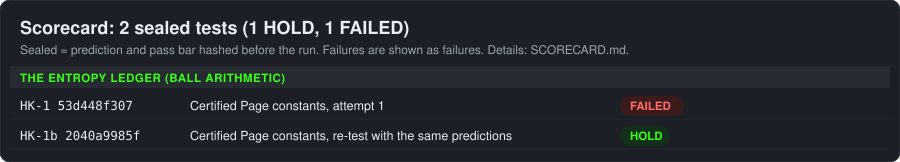
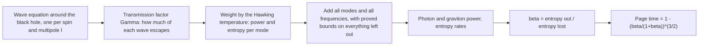

# An evaporating black hole's Page time, pinned to ten digits with proof

**In Don Page's model of black-hole evaporation, the glow carries away 1.4846916919 units of entropy for every unit the hole loses; a computer proof traps this number in a box 1.6 × 10⁻¹⁰ wide, and with it the Page time: 53.81% of the hole's life.**

[](https://doi.org/10.5281/zenodo.24327159)  [](https://github.com/Hashirama1337s)

Moki & Julio · 2026 · version 1.0

**Read** [paper.md](paper.md) · **Re-run** [tools/reproduce.md](tools/reproduce.md) · **Check** [CLAIMS.md](CLAIMS.md) and [SCORECARD.md](SCORECARD.md) · **Specialists** [TECHNICAL.md](TECHNICAL.md)

## In plain words

A black hole is not perfectly black. Stephen Hawking showed in 1974 that it glows faintly, and slowly evaporates. Our
work is about the bookkeeping of that glow, counted in **entropy**: a measure of how many hidden ways a thing can be
arranged, the physicist's word for missing information.

A black hole has an entropy fixed by the area of its surface. As it shrinks, that entropy goes down; the radiation it
sends out carries entropy away, and the radiation's entropy goes up faster. How much faster is one number, β: for every
unit of entropy the black hole loses, the radiation carries about 1.4847 units.

Don Page turned this bookkeeping into a clock. If quantum theory is right that information is never destroyed, the
information that fell in must start coming back out once the radiation holds more entropy than the black hole has
left. That moment is now called the **Page time**: the moment a black hole stops being a one-way door. For a large,
non-spinning black hole that emits only light (photons) and gravitational waves (gravitons), β fixes it exactly: the
Page time comes after 53.81% of its life. At that moment the black hole still has 77% of its mass but has already lost
40% of its entropy.

Page computed β with a computer, wrote that only about four or five digits were reliable, and printed more digits "as
a challenge for someone to do a higher-precision calculation" (Page 2013,
[arXiv:1301.4995](https://arxiv.org/abs/1301.4995)). We took up that challenge with **ball arithmetic**: every number
carries a guaranteed error radius, every rounding goes outward, and every infinite sum and every cut-off integral gets
a proved bound. What comes out is not an estimate but a box that provably contains the true value. A second program,
written blind with a different method, lands inside the box.

**The idea in one picture.** Two bank accounts: the black hole's entropy and the radiation's. Every withdrawal from the
first deposits 1.4847 times as much into the second, so the two balances cross at a fixed fraction of the black hole's
life. **Where the picture breaks.** The radiation's "deposit" is coarse-grained entropy, which ignores the quantum links
between the radiation and the hole. Whether the true (fine-grained) entropy really turns around at the Page time, the
information paradox, is a question about quantum gravity that this work does not touch.


*The black hole's own entropy (blue) falls as it evaporates; the entropy of its radiation (orange) rises 1.4847 times
faster. The two cross at the green dot, the Page time, 53.81% of the way through the black hole's life. The pale green
band, the "Page curve", is what quantum theory predicts if no information is lost: Page's assumption, drawn as a
sketch; nothing here computes or proves it.*

## What we found

All values are for a Schwarzschild black hole of mass M emitting photons and gravitons into empty space, in Planck
units, with Page's definitions.

| Result | Kind | How it was checked | Sealed test |
|---|---|---|---|
| β ∈ [1.4846916919 ± 7.81e-11] | PROVED, computer-assisted | ball arithmetic with proved bounds on every left-out piece; a blind second implementation (Teukolsky equation, Mano-Suzuki-Takasugi series; not rigorous) lands inside the box; two internal referee rounds | HK-1b `2040a9985f`  |
| Page time t\*/t_decay ∈ [0.5381024532 ± 8.99e-11] | PROVED, computer-assisted | as above | HK-1b  |
| Photon power M²P₁ ∈ [3.3638547856e-5 ± 2.57e-16]; total power α ∈ [3.747528778e-5 ± 1.96e-15]; entropy rates M·Ṡ₁ ∈ [1.2683659541e-3 ± 2.47e-14], M·Ṡ₂ ∈ [1.300008786e-4 ± 5.55e-14] | PROVED, computer-assisted | as above; every blind value inside our box | HK-1b  |
| Graviton power M²P₂ ∈ [3.836739925e-6 ± 6.95e-16], inside the interval certified earlier by Newton and about 2.7 × 10⁷ times narrower | PROVED, computer-assisted | sealed prediction "inside Newton 2026"; a null test with the wrong (spin-1) potential misses Newton's interval, as predicted | HK-1b  |
| The certified β lies outside the rounding intervals of both printed values, 1.48472 (Page 2013) and 1.48471 (Perez-Gonzalez 2025) | PROVED, computer-assisted | sealed prediction; the referee's re-score with rounding intervals came after the run and still passes | HK-1b  |
| Two different wave equations for gravitational waves agree at ten test points; the low-frequency limit is reproduced | control | inside the sealed test | HK-1b  |
| First attempt: one quadrature remainder (channel s = 1, l = 8) could not be closed, so no total was produced | | scored FAILED as sealed; fixed and re-tested with the same predictions | HK-1 `53d448f307`  |

Also certified in the same run (closed forms of Page's model): at the Page time the mass is
M\*/M₀ ∈ [0.7730042563 ± 3.34e-11] and the black-hole entropy S\*/S_BH(0) ∈ [0.5975355803 ± 7.48e-11]; the lifetime is
t_decay = [8894.750463 ± 4.34e-7] M₀³.

This does not mean an error in either printed value: both are floating-point computations without proved error
bounds, and Page estimated four to five reliable digits. The result settles the digits he flagged as uncertain.



*The scorecard lists every test whose pass rule was written down and hashed before it ran: two here. The first attempt
failed and is kept on the record; the re-test with the same predictions held. Details: [SCORECARD.md](SCORECARD.md).*

## What we do not claim

- **Only Page's model.** A non-rotating, uncharged black hole emitting massless photons and gravitons into empty space,
  with no incoming radiation. Not covered: rotating (Kerr) or charged black holes; neutrinos or any other species; any
  massive particle. Page's model applies to holes heavy enough that neutrino emission is switched off, which
  Perez-Gonzalez (2025) places above about 10²⁶ g; we do not check that estimate.
- **Only the stated modes.** The greybody factors are those of the Regge-Wheeler equation for spins 1 and 2, all
  multipoles, both polarisations. Nothing about other perturbation types.
- **Nothing about the information paradox.** The Page time here is Page's closed-form definition, the moment the
  coarse-grained radiation entropy equals the black hole's entropy in his model. We do not claim that information comes
  out, how, or when, beyond that definition.
- **Not machine-checked.** The proofs are written out and refereed by internal seats; the finite inequalities they need
  are checked in ball arithmetic, not in a proof assistant.
- **Trust base.** Correct rounding in Arb (python-flint 0.9.0) and correct execution by CPython 3.11.
- **After the fact (POST HOC, not sealed).** The blind agreement, the referee's re-score with rounding intervals, and the
  observation that Page's printed powers sit just below our enclosures were all done after the sealed run.

## Open doors

What this work leaves open, for anyone who wants to take the next step.

- **Spinning black holes.** Real black holes spin, and a spinning (Kerr) black hole radiates differently and also sheds
  its spin. *Status:* Newton (2026, [10.5281/zenodo.22800587](https://doi.org/10.5281/zenodo.22800587), closing
  section) names Kerr as the next step of his certified graviton work. *Start here:* the engine in `code/`
  (hkcore.py) and the bounds in proofs/PROOF.md; the Teukolsky route of the blind check
  (results/blind/BLIND-REPORT.md) already handles spin in principle. *Ceiling:* certified emission constants and Page
  time as functions of the spin.
- **Neutrinos and lighter black holes.** Below about 10²⁶ g a black hole also emits neutrinos, and then β and the Page
  time change; floating-point values exist (Perez-Gonzalez 2025, for example β = 1.61862 with neutrinos). Our engine
  treats integer spins only. *Status:* UNTESTED. *Start here:* code/hk1b_channel.py and code/hkbounds.py: the panel
  quadrature carries over; for spin-1/2 the wave equation, the thermal factor (Fermi-Dirac), the entropy function and
  the tail bounds all change. *Ceiling:* certified constants for every massless species in nature.
- **Machine-checking the finite inequalities.** The proof needs a few dozen finite numerical facts (for example the
  slope condition of the l > 60 lemma and the premises of its far cells). *Status:* UNTESTED. *Start here:*
  proofs/PROOF.md Sections 7-8 and the constants table in Section 10. *Ceiling:* the large-l and comparison steps
  checked by a proof assistant's kernel.

## Loose ends

- **The scorer as run did not follow the sealed rule.** The sealed amendment (AMEND-HK-1-1) compares printed values through their rounding intervals; the scorer compared with the printed points. The internal referee caught it; a re-score with the intervals (`results/hk1b/rescore_hk1b.json`) still passes, but it came after the run.
- **One sentence of the far-cell lemma did not follow as written.** The second referee round found it; the repaired
  argument is annotated in [proofs/PROOF.md](proofs/PROOF.md). No number or code changed.
- **The blind seat remembered the rough answer.** It disclosed a rough recollection of β ≈ 1.4847,
  t\* ≈ 0.538 t_decay and α ≈ 3.747e-5 from general knowledge (results/blind/BLIND-REPORT.md). It did not see our code,
  numbers or bars.
- **Page's printed powers sit slightly low.** His photon and graviton powers lie 1.6 × 10⁻⁵ and 1.9 × 10⁻⁴ (relative)
  below our enclosures; a slightly low total power is consistent with a slightly high β. We did not test the cause
  (POST HOC observation).
- **The neutrino cut-off is borrowed.** The mass above which Page's model applies (about 10²⁶ g) is Perez-Gonzalez's
  estimate; we do not check it.
- **The quick re-run is partial.** `--tier quick` replays only the three cheapest channels; the dominant channels are
  replayed only in the full tier (about 15 minutes).
- **The engine covers the frequencies of this run only** (Mω ≤ 1.6).

## Start here

1. **Two minutes.** Read "In plain words" and look at the entropy picture: the green dot is the Page time.
2. **Fifteen minutes.** Run `python tools/reproduce.py --tier quick` (about 2 minutes; last line
   `[reproduce] ALL CHECKS PASS`) and read [SCORECARD.md](SCORECARD.md), including the failed first attempt.
3. **The real thing.** [paper.md](paper.md) states the result and the method; [proofs/PROOF.md](proofs/PROOF.md) writes
   out every bound with its code location; [CLAIMS.md](CLAIMS.md) gives every number's source file;
   [TECHNICAL.md](TECHNICAL.md) has the full specialist summary and two more figures.

## How it works



A wave trying to leave a black hole has to tunnel through a hill of curved space. The fraction that gets through, the
**greybody factor** Γ, depends on the wave's frequency, its spin and its angular pattern l. Hawking's temperature tells
how many waves of each frequency the black hole tries to send. Multiply, add up all patterns and all frequencies, and you
get the power and the entropy the black hole radiates. β and the Page time follow by two short formulas. Where Γ is
tiny, the equation is not solved; a proved upper bound (Newton's comparison-cell idea) takes its place, and a lemma
covers all l > 60 at once.

## Reproduce and reuse

From the repository root (Python 3.11, python-flint 0.9.0, sympy for the identity check; mpmath for the blind tier):

```
python tools/check_pins.py
python tools/reproduce.py --tier quick
python tools/reproduce.py --tier full
python tools/reproduce.py --tier blind
```

`check_pins.py` checks every sealed or recorded file against its ledger pin and every file against `MANIFEST.sha256`.
The quick tier takes about 2 minutes, the full tier (the sealed main run itself, compared with the shipped result,
ledger and log) about 15 minutes, the blind tier (the blind second implementation, not rigorous) about 7 minutes.
Expected last line: `[reproduce] ALL CHECKS PASS`. Details: [tools/reproduce.md](tools/reproduce.md).

**Reuse.** A certified Schwarzschild scattering engine for integer spins (greybody factors with proved error bars at
the frequencies covered, Mω ≤ 1.6 in this run), and the band-bound and large-l lemma for discarding modes with a proof.

## Credit and prior work

- **Page** (1976) computed the emission rates of photons and gravitons from a Schwarzschild black hole; Page (2013) gave
  β = 1.48472 and the time dependence of the radiation entropy in this model, and invited the higher-precision
  recomputation done here.
- **Perez-Gonzalez** (2025) recomputed β in floating point (1.48471), including other species and masses.
- **Newton** (2026, [10.5281/zenodo.22800587](https://doi.org/10.5281/zenodo.22800587)) certified the graviton power
  first, at 1% width, with ball arithmetic, comparison cells and a sech² bound on tiny transmission factors. Our band
  bounds follow that idea, with our own proofs and code. Our graviton power is an independent enclosure inside his
  interval.
- **What we found no earlier version of** (search of arXiv, INSPIRE and Zenodo to 17 November 2026): certified
  enclosures of the photon power, the total power α (its graviton part was certified earlier by Newton), both entropy
  rates, β and the Page time for this model. The two dated prior-art searches are shipped in
  [results/prior-art/](results/prior-art/):
  [results/prior-art/gate-1/GATE-HAWKING.md](results/prior-art/gate-1/GATE-HAWKING.md) and
  [results/prior-art/gate-2/GATE-REFRESH.md](results/prior-art/gate-2/GATE-REFRESH.md).

## Words you will meet

- **Hawking radiation**: the faint thermal glow of a black hole, predicted by Hawking in 1974.
- **Entropy**: a count of hidden arrangements; for a black hole, a quarter of its horizon area in Planck units.
- **Coarse-grained entropy**: the entropy of the radiation counted on its own, ignoring its quantum links to the hole.
- **Greybody factor Γ**: the fraction of a wave that escapes through the curved-space hill around the black hole.
- **β**: entropy gained by the radiation divided by entropy lost by the black hole.
- **Page time**: in Page's model, when the radiation's coarse-grained entropy equals the black hole's entropy.
- **Ball arithmetic**: every number carries a guaranteed error radius, so results are bounds, not estimates.
- **Sealed test**: a prediction and its pass bar, hashed before the run and scored as written.
- **Seat**: a separate internal working session of the lab with its own files. Referee seats and blind seats are
  internal checks, not external peer review.

## How to cite

```
Moki & Julio (2026). When does a black hole stop being a one-way door? Certified Page evaporation constants for a Schwarzschild black hole emitting photons and gravitons. Version 1.0. Zenodo. https://doi.org/10.5281/zenodo.24327159
```

The DOI always resolves to the newest archived version. Version 1.0 is
[10.5281/zenodo.24327160](https://doi.org/10.5281/zenodo.24327160). Machine-readable: [CITATION.cff](CITATION.cff).
Text and data: CC BY 4.0 (`LICENSE`). Code: MIT (`LICENSE-CODE`).

## Related projects

- [certified-quantum-ball](https://github.com/Hashirama1337s/certified-quantum-ball): the certified one-loop quantum push on the Evans-Coleman critical solution, and its sign (toward trapping)
- [certified-bowen-york-spin](https://github.com/Hashirama1337s/certified-bowen-york-spin): the certified spin ceiling of Bowen-York black holes
- [certified-evans-coleman](https://github.com/Hashirama1337s/certified-evans-coleman): a certified critical collapse of radiation at the threshold of black-hole formation
- [large-d-gregory-laflamme](https://github.com/Hashirama1337s/large-d-gregory-laflamme): when a black string cracks, to order 1/n¹²
- All projects: [the Moki & Julio lab map](https://github.com/Hashirama1337s)

---

*Prepared with AI assistance; what was checked, and by what, is stated above.*
